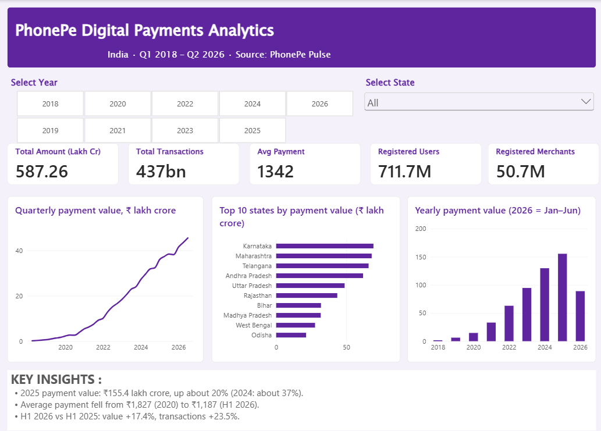

# Power BI dashboard

A 3-page dashboard on PhonePe Pulse data (India, Q1 2018 to Q2 2026). It uses the cleaned tables in [`data/cleaned`](../data/cleaned).



## Files
| File | What it is |
|---|---|
| `phonepe.pbix` | The Power BI report (open it with the free Power BI Desktop for Windows) |
| `phonepe_theme.json` | Colour theme (PhonePe purple `#5F259F`), imported via View > Themes > Browse for themes |

## Opening the report
The report reads the four CSV files from `data/cleaned`. If Power BI cannot find them, go to **Home > Transform data > Data source settings > Change source** and point each file to where you saved it.

## Pages
| Page | What it shows |
|---|---|
| **Overview** | Year and state slicers; cards for payment value, transactions, average payment, registered users and registered merchants; quarterly value trend; top 10 states; yearly value |
| **States & Districts** | State table (value, share of total, YoY growth, transactions per user, average payment); share-of-value treemap; top 10 districts |
| **Users & Merchants** | Merchants per 1,000 users, average payment, transactions per user; payment category mix by year; users vs engagement by state; average payment by quarter; top 10 states by merchants |


## Data model
- Fact tables: `fact_state`, `fact_district`, `fact_category`.
- Dimensions: `dim_period` (one row per quarter) and `dim_state` (built with `DISTINCT(fact_state[state])`).
- Relationships (one-to-many, single direction): `dim_period[period]` to the three fact tables, and `dim_state[state]` to the three fact tables.
- Extra columns: `dim_period[period_index]` and `fact_district[District Label]` (district + state, because Bilaspur, Hamirpur and Pratapgarh exist in more than one state).

## Key measures
| Measure | Definition |
|---|---|
| Total Amount (Cr) | Sum of `txn_amount_inr` / 10,000,000 |
| Total Amount (Lakh Cr) | Sum of `txn_amount_inr` / 1,000,000,000,000 |
| Total Transactions | Sum of `txn_count` |
| Avg Payment | Total amount / total transactions (weighted, not an average of averages) |
| Registered Users, Registered Merchants | Value at the **latest quarter in view** (they are running totals) |
| Txns per User (Qtr Avg) | Average over the quarters in view of transactions / registered users |
| Merchants per 1,000 Users | Registered merchants / registered users x 1,000 |
| Share of Total % | State value / value of all states, in the same period |
| YoY Growth % | Same quarters, current year vs previous year (needs a single year selected) |
| District Amount (Cr) | Sum of district `txn_amount_inr` / 10,000,000 |
| Category Transactions | Sum of category `txn_count` |

```
Registered Users =
VAR k = MAX(dim_period[period_key])
RETURN CALCULATE(SUM(fact_state[registered_users]), dim_period[period_key] = k)

YoY Growth % =
VAR yr = SELECTEDVALUE(dim_period[year])
VAR qs = VALUES(dim_period[quarter])
VAR prev = CALCULATE([Total Amount (Cr)], REMOVEFILTERS(dim_period), dim_period[year] = yr - 1, qs)
RETURN IF(ISBLANK(yr), BLANK(), DIVIDE([Total Amount (Cr)] - prev, prev))

Txns per User (Qtr Avg) =
AVERAGEX(VALUES(dim_period[period]), DIVIDE([Total Transactions], [Registered Users]))
```

## Validation against the SQL results
| Selection | Check | Value |
|---|---|---|
| None | Payment value / transactions / avg payment | 587.26 lakh crore / 437.4 bn / ₹1,342 |
| None | Registered users / merchants (2026 Q2) | 711.7M / 50.7M |
| 2025 | Payment value / transactions / avg payment | 155.38 lakh crore / 128.5 bn / ₹1,209 |
| 2025 | Top district | Bengaluru Urban (Karnataka), ₹791,696 crore |
| 2025 | Total YoY growth | +19.8% |

## Notes
- 2026 has only Q1 and Q2, so compare it with the first half of 2025.
- Registered users and merchants are running totals and are never added across quarters.
- Blank merchant values mean no data in the source (mostly 2018), not zero.
- The year and state slicers are synced across all three pages.
- Figures describe PhonePe's own data, not the whole Indian digital-payments market.
